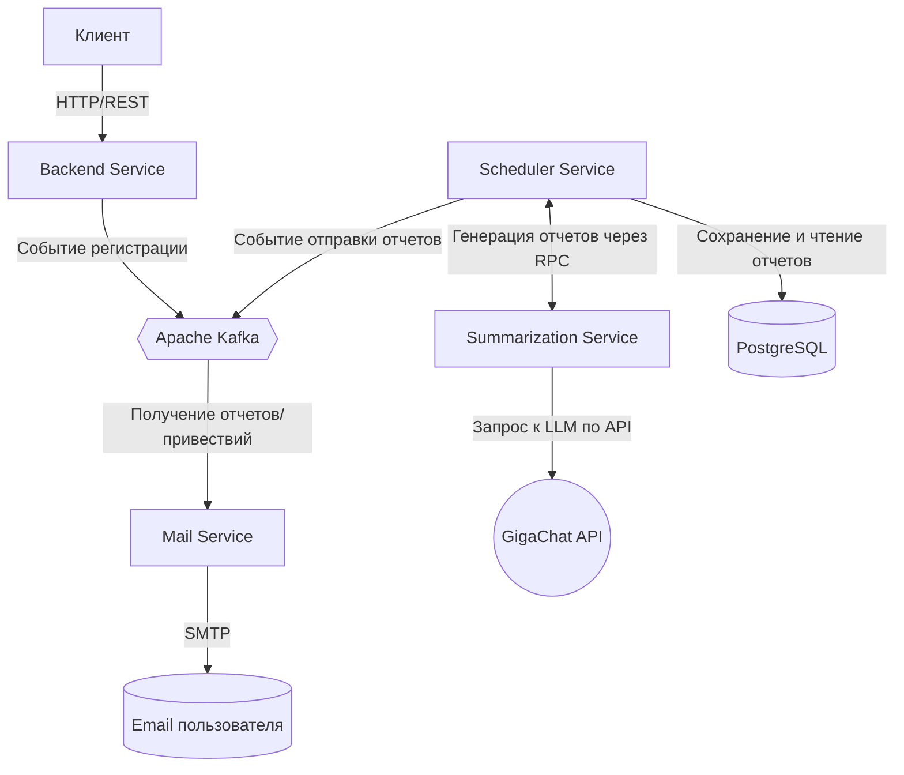

# Проект ["Планировщик задач"](https://zhukovsd.github.io/java-backend-learning-course/projects/task-tracker/)

Микросервисное приложение для управления своими задачами, используется в качестве TODO листа.

### Функциональность
Работа с пользователями:

* Регистрация
* Авторизация
* Logout

Работа с задачами:

* Создание, редактирование (каждая задача имеет заголовок и описание)
* Пометка задачи как сделанной
* Удаление

Оповещение пользователей по email:

* Приветственное письмо
* Каждый день в полночь отчёт о том, какие задачи были сделаны за прошедшие сутки,
  какое количество осталось невыполненными

### Архитектура
* [Backend Service](https://github.com/makson4986/TaskTrackerBackend) - приложение предоставляющие API для работы с пользователя и задачами
* [Scheduler Service](https://github.com/makson4986/TaskTrackerScheduler) - планировщик, запускающий ежедневную генерацию отчетов
* [Mail Service](https://github.com/makson4986/TaskTrackerMail) - сервис для рассылки приветственных писем и ежедневных отчетов
* [Summarization Service](https://github.com/makson4986/TaskTrackerSummarization) - приложение, отвечающее за генерацию отчетов и интеграцию с API GigaChat

### Технологический стек
* Java 25
* Spring Boot
* Spring Security
* Spring Validation
* Apache Kafka
* Java Mail Sender
* Lombok
* MapStruct
* PostgreSQL
* GigaChat API
* Docker & Docker Compose
* JUnit
* Mockito
* Testcontainers
* Nginx
* CI/CD

### Схема взаимодействия микросервисов



### Деплой

Для запуска приложений необходимо предустановить Docker & Docker Compose

1. Клонируйте данный [репозиторий](https://github.com/makson4986/TaskTracker):    
`git clone https://github.com/makson4986/TaskTracker.git`
2. Перейдите в папку `TaskTracker`
3. Создайте в текущей папке файл `.env` и заполните его переменными:
```
Переменные для базы данных

DB_HOST=POSTGRES_HOST_IN_DOCKER
DB_PORT=POSTGRES_PORT
DB_USERNAME=USERNAME
DB_PASSWORD=PASSWORD
DB_NAME_BACKEND=DB_NAME_FOR_BACKEND
DB_NAME_SCHEDULER=DB_NAME_FOR_SCHEDULER
```

```
Кроны для генерации отчетов и отправки их на почту
SCHEDULER_CRONS_GENERATION_REQUEST=CRONS_FOR_GENERATION_REPORTS_DEFAULT_0_AM
SCHEDULER_CRONS_SENDING_REPORTS=CRONS_FOR_SENDING_REPORS_VIA_EMAIL_DEFAULT_6_AM
```

```
Переменные для SMTP сервера

MAIL_HOST=HOST
MAIL_PORT=PORT
MAIL_USERNAME=USERNAME
MAIL_PASSWORD=PASSWORD
MAIL_FROM=FROM_EMAIL
```

```
Переменные для Kafka

KAFKA_BROKER_URL=BROKERS_URL
KAFKA_GREETING_TOPIC=TOPIC_NAME_FOR_GREETING
KAFKA_SUMMARIZATION_REQUESTS_TOPIC=TOPIC_NAME_FOR_SUMMARIZATION_REQUESTS
KAFKA_SUMMARIZATION_RESPONSES_TOPIC=TOPIC_NAME_FOR_SUMMARIZATION_RESPONSES
KAFKA_REPORT_TOPIC=TOPIC_NAME_FOR_REPORTS_READY_SENDING
```

```
Переменные для интеграции с GigaChat API

LLM_MODEL=GIGA_CHAT_MODEL
LLM_AUTH_URL=https://ngw.devices.sberbank.ru:9443/api/v2/oauth
LLM_API_URL=https://api.giga.chat/v1
LLM_AUTHORIZATION_KEY=AUTHORIZATION_KEY
```

```
JWT_SECRET=JWT_SECRET
TASK_BACKEND_URL=BACKEND_URL_IN_DOCKER
```
4. Для получения Docker Image и запуска приложения используйте данную команду:   
`docker compose up -d --build`